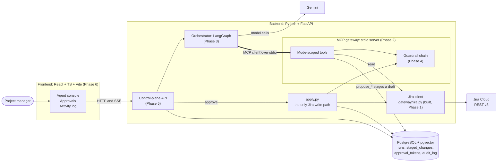
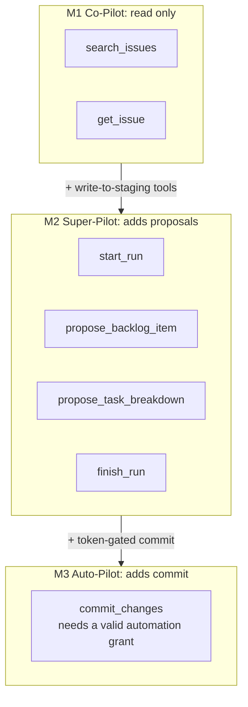
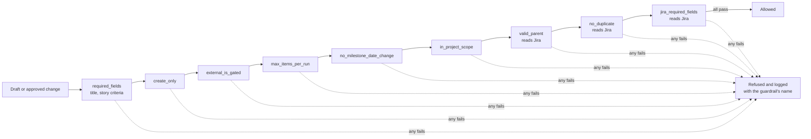
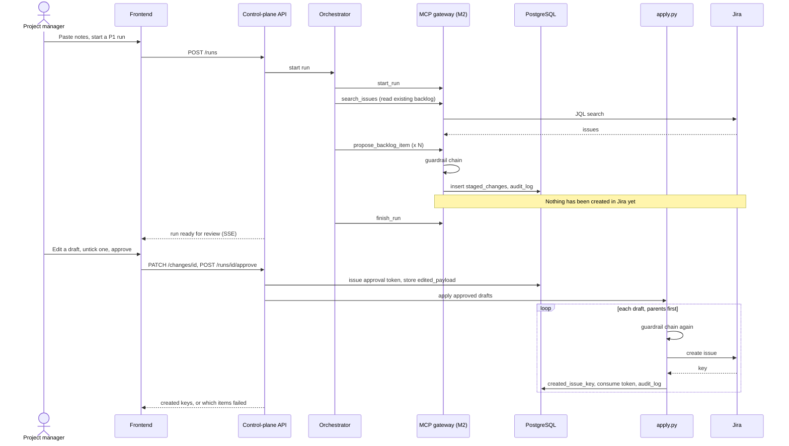
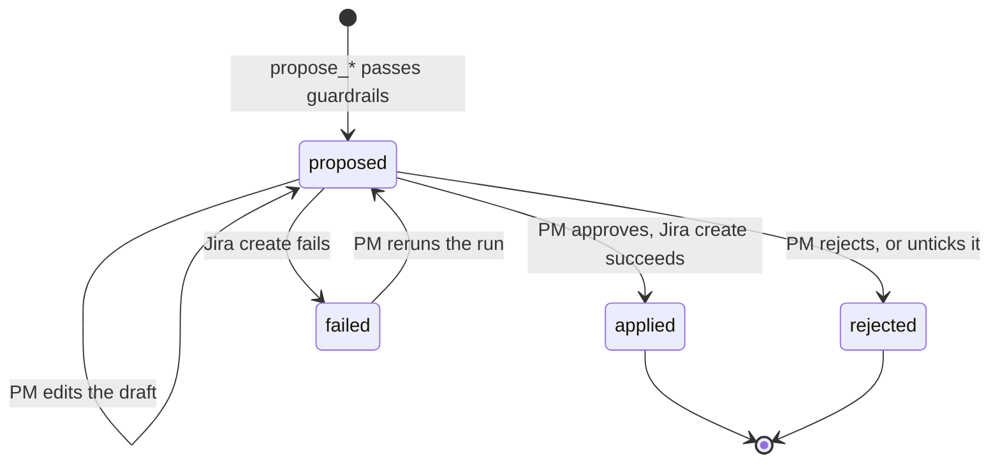
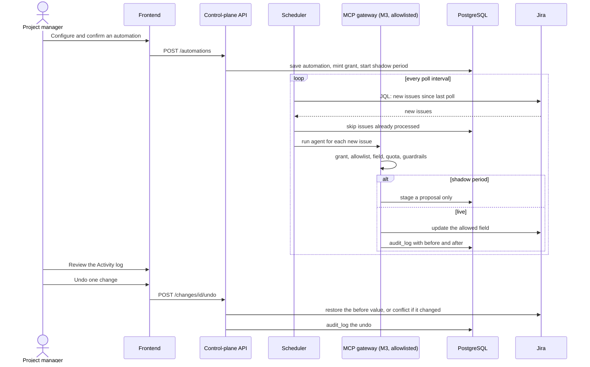

# Architecture

The decisions below are settled; they come from a working prototype and the Phase 0 decisions in
`phases.md`. If you think one is wrong, say so in a PR or issue rather than quietly building around it.

Status: the Jira client, the Postgres schema, the mode-scoped gateway, the orchestrator, the guardrails, the API and the frontend are built (Phases 1 to 6). The
diagrams show the target design; each box is labelled with the phase in `phases.md` that builds it.

## What this is, and is not

CogniPM is a control plane for agentic project management **on top of Jira**. Jira owns the project data.
CogniPM owns the oversight layer: how a human delegates to an agent, at what autonomy mode, and how they
review the result.

It is **not** a project-management tool (no backlog CRUD, board or gantt: Jira does that), and **not** a
general chat assistant (the one narrow exception is the read-only Co-Pilot chat, below). It does not talk to
real email, calendar or meeting systems.

The MVP does two jobs, both of which **create** Jira issues after a human approves them:

- **P1, backlog drafting:** turn meeting notes or a requirements document into draft stories.
- **P2, task breakdown:** turn an approved story into draft sub-tasks.

## System overview

Two lines in this diagram carry the design:

- The orchestrator reaches Jira **only** through the gateway, as a real MCP client over stdio (thick arrow). It
  never imports the gateway's tool classes, so it can only do what the gateway registered.
- The only path from a draft to a Jira write is `apply.py`, which runs when a human approves through the API.
  Nothing an agent can call reaches it.

## The core decision

> **Autonomy is enforced by the tool layer, not by the prompt.**

The mode a task runs in decides **which MCP tools exist for that run**. We never ask a model to behave as a
Co-Pilot; we hand it a tool set that makes anything more impossible. If you catch yourself writing "the agent
should ask permission before..." into a system prompt, stop: that belongs in the gateway.

## Autonomy modes

Three modes. Code, tests, the database and the UI all use `M1`, `M2` and `M3` (decision D1 in `phases.md`).
There is no separate L-code in the code base.

| Mode | Name | Tools the agent gets | Where output lands |
|---|---|---|---|
| M1 | Co-Pilot | read only: `search_issues`, `get_issue` | chat answer |
| M2 | Super-Pilot | read + `start_run`, `propose_backlog_item`, `propose_task_breakdown`, `finish_run` | `staged_changes`; the PM edits, then approves, rejects or reruns |
| M3 | Auto-Pilot | read + `start_run`, `propose_*`, `commit_changes`, narrowed to the automation's allowlist | changes are committed in the background inside the automation's grant; the PM reviews and can undo afterwards |

M2 and M3 differ in **who starts the run and when the human decides**, not only in the tool list:

| | M2 Super-Pilot | M3 Auto-Pilot |
|---|---|---|
| Started by | The PM, from the Agent console | A trigger (a new Jira issue matching a filter) |
| Human decides | After each proposal: edit, approve, reject, rerun | Once, before: the PM sets up and confirms an automation |
| Who writes to Jira | The API, when the PM approves | The agent, by calling `commit_changes` inside its grant |
| Human review | Before the write | After the write, in the Activity log, with undo |

- **M1 registers no write tools at all.** Not disabled: absent from the tool list. A test asserts this.
- **`propose_*` never touches Jira.** It writes to the `staged_changes` table only.
- **M3 is a later phase** (Phase 8); see "Automations" below. Until then `commit_changes` exists only for
  someone driving a run by hand (for example from Claude Code), and it succeeds only with an unexpired,
  unconsumed token that belongs to that run.
- **There is no mode with no human in the loop**, deliberately. `external` actions stay gated in every mode.
- **The locked review variant (old L3) is dropped** (decision D2). It differed from M2 only in the UI, not in
  the tool layer, so it was not an autonomy level in the sense this design uses.
- **Academic mapping, for the report only.** The framework is Assalaarachchi et al., arXiv:2601.16392. M1 is
  roughly L1 AI-Assisted, M2 is roughly L2 Human-AI Collaborative, M3 is roughly L4 Guided AI-Autonomy. In the
  report, pair a mode with its academic name; never use the L-codes in code.

## Guardrails sit above the modes

Server-side validators in the gateway, applied identically at every mode. An agent never negotiates with a
guardrail: the call is refused and the refusal is logged. Never implement a guardrail as a prompt instruction.

They run **twice**: when a draft is proposed, and again immediately before each Jira write in `apply.py`. Each
rule reads Jira's state at that moment, so an approval given earlier cannot get around something that has since
changed (a title someone created by hand in the meantime, a parent that was closed). The cheap local rules run
first, so a bad draft usually costs no Jira request at all.

Each staged change carries an **action class** (`read`, `internal`, `structural`, `external`). Creating issues is
`structural`. `external` is never committed automatically: `external_is_gated` refuses it when no person is
approving (M3's `commit_changes`), at every mode. An approval is also tied to the drafts that existed when it was
issued: a draft staged afterwards is not covered, and `commit_changes` refuses.

Known limit: `no_duplicate` compares exact titles (ignoring case and spacing) against the 100 most recently
created open issues, so near-duplicates and older issues get through. Tune it on real runs.

## How a write reaches Jira

1. An agent run calls gateway tools. `propose_*` tools only write to the **staging table**; they never touch
   Jira. Each proposal needs reasoning, assumptions and at least one cited source passage from the input.
2. A human reviews the staged drafts: edits them, approves a subset, rejects them, or asks for a rerun.
3. **Approving is a human action handled by the API**, not an MCP tool call. The human is what writes to Jira,
   through `apply.py`, which re-runs the guardrails immediately before each write. An approval token is issued
   and consumed on every approval for audit parity.
4. `apply.py` creates **parents before children** and stops at the first Jira failure, reporting exactly which
   items were and were not created. It never leaves a silent half-batch.

A staged change moves through a small set of states, and an applied change can no longer be edited:

## Automations (M3, Phase 8)

An M3 run is not started by a person. A PM **sets up an automation once**, confirms it, and from then on it
runs in the background for that one task. Example: task "estimate story points", instruction "add story points
whenever a new task or story is added", allowed tools `get_issue` and `set_story_points`, allowed field
`story points`, at most 20 changes a day.

- **Confirming the automation is the human authorisation.** It mints a **grant**: scoped to that automation,
  revocable and expiring. It replaces the per-run approval token, because nobody is present to approve each run.
- **A run's tool set is the automation's allowlist.** The agent still cannot do more than the gateway
  registered for it. `commit_changes` also checks the grant is live, the field is allowed, the action class is
  not `external`, the project matches and the daily quota is not used up.
- **Triggering is by polling** a JQL filter (webhooks need a public URL). Each issue is processed at most once
  per automation, and the agent's own edits never retrigger it.
- **New automations start in a shadow period:** they only propose, so the PM sees what they would do before
  they are allowed to write.
- **Every change is reviewable and reversible.** The audit log stores the before and after value, and **undo**
  is a human action through the API that restores the before value, refusing with a conflict if the value has
  changed since. Undo is never an agent tool and is itself audited.
- **Undoing a created issue** cannot restore a previous value, so it follows fixed rules. Only issues recorded
  in the audit log as created by CogniPM can be undone. **Close is the default** (the client reads the issue's
  transitions and picks one that ends in a done status, then labels and comments). **Delete happens only if
  nobody has touched the issue** (no edits, comments or links, checked from its changelog) and the API user has
  delete permission; otherwise undo returns a conflict and offers Close.
- **Hard floors that no automation can lower:** `external` actions are always gated, the guardrails still run,
  and an automation can touch only the fields it lists. Pausing or revoking stops it before its next run.

M3 needs `create_only` widened: story points are an update to an existing issue. That happens per automation
through an `update_allowed_fields` guardrail, never globally, so M2 stays create-only.

## Provenance

Jira's history attributes every change to the API user, so provenance (which agent, in which mode, approved by
whom, what was edited) lives in our own database as an **append-only audit log**. Enforce append-only in the
database with a trigger that rejects UPDATE, DELETE and TRUNCATE; do not rely on convention. Edits are stored
as a before/after diff, and each run records the model, token counts and what it was a rerun of, because the
study measures edit rate, rejection rate and time to decision.

## Layout

| Path | Holds | Phase |
|---|---|---|
| `backend/cognipm/gateway/jira.py` | Jira REST client, ADF helpers, key validation | 1 (built) |
| `backend/cognipm/gateway/server.py`, `apply.py`, `guardrails.py` | Mode-scoped MCP tools, the one Jira write path, the guardrail chain | 2 and 4 (built) |
| `backend/cognipm/db/` | Postgres schema, migrations, `log_audit()` | 2 (built) |
| `backend/cognipm/orchestrator/` | LangGraph runs (P1, P2, M1 chat) that call the gateway over stdio | 3 (built) |
| `backend/cognipm/api/` | FastAPI control-plane API; its OpenAPI schema is `frontend/src/api/openapi.json` | 5 (built) |
| `backend/cognipm/automations/` | M3 automations: grants, poll scheduler, undo | 8 |
| `frontend/src/` | React app: Agent console, Approvals, Activity log | 6 (built) |

## Known gaps and RAG

`docs/phases.md` has a "Hardening and gaps" section (H1 to H14) listing what a real practitioner would hit and
the phase that fixes each. The ones that change the design are:

- **Creates must be idempotent.** Each issue is stamped with its draft id and `apply.py` checks for the stamp
  before creating, so a retry never produces a duplicate (H1). Every created issue also carries the label
  `cognipm-drafted` and a provenance comment (H2).
- **RAG is optional and must not confound the study.** It would be a read-only `search_knowledge` gateway tool,
  present at every mode, and drafts would cite retrieved passages labelled "from history". It is kept identical
  across compared conditions, or off during evaluation, because better drafts would otherwise change edit rate
  for reasons unrelated to the oversight mode.
- **The review screen is a research instrument.** Review fatigue is the main risk of human oversight, so the UI
  highlights cited quotes, flags assumptions, requires explicit ticks, and records time per decision (H6).

## Jira specifics that will bite you

- **Story points are a custom field and the id varies by site.** Never hardcode `customfield_10016`. Discover
  it once with `scripts/check_connection.py` and keep it in `.env` as `JIRA_STORY_POINTS_FIELD`.
- **The JQL search endpoint has changed.** The client uses `POST /rest/api/3/search/jql`; the older
  `GET /rest/api/3/search` is deprecated.
- **Descriptions and comments use ADF** (Atlassian Document Format), not plain text or markdown. Use the
  helpers in `gateway/jira.py`.
- **Sprints live behind the Agile API** (`/rest/agile/1.0/...`), which this project does not use.
- **Issue keys that reach a JQL string or a URL path come from model output**, so never interpolate one raw.
  `validate_issue_key()` (`^[A-Z][A-Z0-9_]+-\d+$`, full match) and `key_in_jql()` in `gateway/jira.py` are the
  only way a key may be used; the client calls them itself.
- **Issue type ids differ per site, and the sub-task type's name varies** ("Sub-task" here). Look types up by
  name through `JiraClient.issue_type()`, and find the sub-task type by its `subtask` flag.
- **Acceptance criteria live in the description** (an "Acceptance criteria" heading and a bullet list, built by
  `draft_to_adf`), not a custom field, so nothing depends on site configuration.
- **Deleting is for the sandbox script only.** `delete_issue()` refuses any issue not labelled
  `cognipm-sandbox`, and the gateway must never expose it.
- **The API has no login yet** (one implicit reviewer). Do not expose it publicly until that changes: anyone
  who can reach it could approve a write to Jira.
