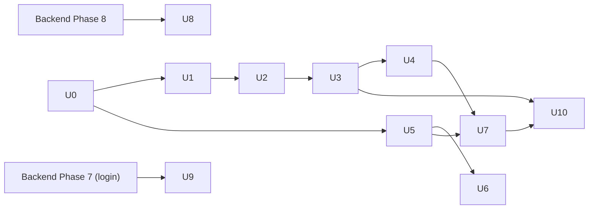

# UX implementation phases

How we build the pages in [ux-plan.md](ux-plan.md), in order. Work happens on the branch
**`feature/uiux-improvement`**. Each phase is small enough to finish, test and commit on its own, so the app works
after every phase and we can stop at any point.

Phases are named **U0, U1, U2...** so they are not confused with the backend phases (1 to 10) in
[phases.md](phases.md). Some UI phases depend on backend phases; that is noted on each.

## The plan at a glance

| Phase | What | Needs backend change? | Size | When |
|---|---|---|---|---|
| **U0** | Foundations: sidebar from one config, shared page pieces | no | half a day | before the deadline |
| **U1** | **Home** | no | 1 day | before the deadline |
| **U2** | **Settings** (read-only, with connection tests) | yes, small | 1.5 days | before the deadline |
| U3 | Approvals tabs and run tabs | no | 1 to 2 days | after the MVP |
| U4 | Activity: links, search, date range, full export | yes, small | 1 to 2 days | after the MVP |
| U5 | **Library: Created issues** | yes, small | 1.5 days | after the MVP |
| U6 | **Library: Sources** (saved documents) | yes, new table | 2 to 3 days | later |
| U7 | **Insights** (the dashboard) | yes | 2 to 3 days | later (Phase 10) |
| U8 | **Automations** page | waits for backend Phase 8 | 2 days | with Phase 8 |
| U9 | Account menu and roles | waits for backend Phase 7 (login) | 1 day | with Phase 7 |
| U10 | Polish: accessibility, small screens, onboarding guide | no | 2 days | last |



### Suggested calendar (MVP deadline: end of November)

| Days | Work |
|---|---|
| Mon 23 Nov | U0, start U1 |
| Tue 24 Nov | Finish U1 |
| Wed 25 to Thu 26 Nov | U2 |
| Fri 27 to Sun 29 Nov | **Buffer.** Fix what teammates find while testing PR #5, record the demo, freeze. |
| December onwards | U3, U4, U5, then the rest as the backend phases land |

If time runs short, **cut in this order:** the Home checklist, then the Settings "Test" buttons, then the whole of U2.
Never cut the buffer.

## How every phase is done

A phase is finished only when all of these are true:

1. The new page works in a real browser against the real API (look at it, do not only trust the tests).
2. **Tests** are added: one for the normal path and at least one for an empty state and one for an error state.
3. `npm run lint`, `npx tsc --noEmit`, `npm test` and `npm run build` pass. If the API changed: backend `ruff`,
   `pytest`, then `python scripts/export_openapi.py` and `npm run gen:api`, and commit both generated files.
4. `README.md` (if setup or pages changed) and the status lines in [ux-plan.md](ux-plan.md) are updated.
5. One commit per phase, with the suggested message below.

Rules that apply to every page:

- **Plain words.** No internal names like `staged_changes` or `M2` on screen.
- **Every page has a good empty, loading and error state** (U0 provides the pieces).
- **Nothing that looks clickable does nothing.** Do not add a link to a page that does not exist yet.
- **Keyboard and screen-reader basics:** labels, roles, visible focus, no information carried by colour alone.

---

## U0. Foundations

**Status: done.** One deliberate change from the plan below: there is no `/home` placeholder route. Home is listed in
`nav.ts` with `enabled: false`, and the route arrives with U1, so no address leads to an empty page.

**Goal:** make the sidebar and page layout easy to extend, so each later phase only adds a page.

**Build (frontend only):**
- **One navigation list.** Move the sidebar items into a single config (`nav.ts`): label, path, section (WORK or
  RECORD), and an `enabled` flag. The sidebar and the page titles both read it. Adding a page is then one line, and a
  page that is not built yet simply is not listed.
- **Shared page pieces** in `components/`:
  - `PageHeader` (title, short description, optional action buttons)
  - `EmptyState` (a sentence plus one clear action)
  - `ErrorState` (what went wrong in plain words, with a Retry button)
  - `Tabs` (an accessible tab bar: arrow keys move between tabs)
  - `StatCard` (a label and a number, for Home and Insights)
- **Routes:** add the `/home` route as a placeholder and keep `/` redirecting to the console until U1 ships.
- Replace the one-line empty and error messages on the current pages with `EmptyState` and `ErrorState`.

**Tests:** the nav config drives the sidebar (an item with `enabled: false` is absent); `Tabs` works by keyboard; each
shared piece renders its states.

**Done when:** the existing pages look the same but use the shared pieces, and the sidebar is built from `nav.ts`.

**Commit message:**
```
refactor(frontend): drive the sidebar from one config and add shared page pieces
```

---

## U1. Home

**Status: done.** Home is the first page and `/` opens it. The "Recently" times show the exact date and time when you
hover over them.

**Goal:** a starting point that answers "what needs me, and what can I do next?".

**Build (frontend only; the data already exists):**
- Route `/home`, first item in the sidebar, and make `/` open it.
- **Needs you:** waiting runs from `GET /api/runs` (task, scope, number of drafts, how long waiting, a **Review**
  button). Runs that failed with drafts left show **Open to retry**, linking to the review page. Empty state: "Nothing
  is waiting."
- **Start something:** three buttons that open the console in the right place: Draft a backlog
  (`/console?mode=M2`), Break down a story (`/console?mode=M2&task=p2`), Ask the Co-Pilot (`/console`). Add the
  `task` option to the task form so the deep link selects the right task.
- **Recently:** the last five entries from `GET /api/audit?limit=5`, in plain words (reuse `actionLabel`,
  `describeDetail`), each linking to its run when it has one.
- **Getting started checklist,** worked out from data, nothing stored:
  Jira connected (`/api/project` answers) · asked a question (a chat exists) · ran a first draft (a run exists) ·
  approved an issue (an audit row of type "changed Jira" exists). It disappears once all four are done, and a "Hide"
  link is remembered in the browser.

**Tests:** shows waiting runs and their review links; empty state; failed-run retry link; the checklist ticks from the
data; each Start button navigates correctly; error state when the API is down.

**Done when:** a brand-new user sees the checklist and three Start buttons; a returning user with a waiting run sees it
first and can open it in one click.

**Commit message:**
```
feat(frontend): add a Home page with what needs you, quick starts and a first-run checklist
```

---

## U2. Settings

**Status: done.** Differences from the plan: the guardrail sentences live in `api/routes/settings.py` (the docstrings
in `guardrails.py` are written for developers, and a test fails if a rule has no sentence); the Jira test reports a
display name, never an email; Settings is a separate `SYSTEM` group at the bottom of the sidebar.

**Goal:** show how the system is set up and what the AI is allowed to do. Read-only, plus connection tests.

**Build, backend:**
- `GET /api/settings` returns, **never including any secret**: the Jira site and project, whether the model key is set
  and the model name, the limit on issues per run, the list of guardrails (name and one plain sentence each), and what
  is sent to the model. A test checks that no key, token or email appears in the response.
- `POST /api/settings/test-jira` calls Jira's "who am I" and returns `{ok, signed_in_as, problem}`.
- `POST /api/settings/test-model` makes the smallest possible model request and returns `{ok, problem}`, with a
  readable message for "out of credit" and "bad key". The button says it uses a few tokens.
- Give each guardrail a `description` so the page can list them (the code already has one-line docstrings).

**Build, frontend:** route `/settings`, pinned at the bottom of the sidebar. Sections: **Connections** (Jira, model,
each with **Test**), **What each mode can do** (from `GET /api/modes`), **Rules and limits**, **Data and privacy**
(text for now; delete buttons come with U6), **About** (version, link to the README and the guide).

**Tests:** backend: no secrets in the response, test endpoints with a fake Jira and a fake model, including failure
messages. Frontend: renders every section; Test shows success and failure states; the modes list matches the API.

**Done when:** a teammate can open Settings and see "Jira connected as X, model reachable, Co-Pilot has 2 tools, these
nine rules apply", and an out-of-credit model shows a clear message here.

**Commit message:**
```
feat(settings): add a Settings page with connection tests, mode permissions and rules
```

---

## U3. Approvals tabs and run tabs

**Status: done.** The "Open all created issues in Jira" link is a Jira search for the created keys. The Drafts panel is
hidden, not removed, when you switch tabs, so ticks and half-typed edits survive. The run page and Approvals were not
checked visually against real run data (the dev database has no runs); the tests cover them.

**Goal:** separate "needs me" from "history", and make one run easy to understand.

**Build (frontend; the data exists):**
- **Approvals page:** tabs **Waiting** and **History**. History gets a status filter and a search box (by scope).
  Each waiting item shows its age and is flagged after one day.
- **Run page:** tabs **Drafts** (as now), **Steps** (the run's step list and token use, from the run detail), **History**
  (that run's audit rows, from `GET /api/audit?run_id=`).
- **After approval:** show "Open all created issues in Jira" and "Start another task". Make **Back** return to where
  the user came from (use the browser history, with a fallback to Approvals).

**Tests:** tab switching and search; the flag on old items; Steps and History tabs render their data; Back behaviour.

**Done when:** the long review page is split into three clear tabs and Approvals no longer mixes inbox and archive.

**Commit message:**
```
feat(frontend): split Approvals into Waiting and History, and add Steps and History tabs to a run
```

---

## U4. Activity: links, search, date range, full export

**Goal:** make the record usable for review and for the study.

**Build, backend:** extend `GET /api/audit` with `from`, `to` and `q` (text search in the detail). Add
`GET /api/audit/export.csv` that streams **every** matching row (not just the first 500), reusing the same
formula-defusing rule as the browser export.

**Build, frontend:** every row's run id links to its run; a date-range picker and a search box; "Export everything"
uses the new endpoint.

**Tests:** backend filters, and that the CSV defuses cells starting with `=`, `+`, `-`, `@`; frontend filters, links and
the export button.

**Done when:** you can find "everything that happened last Tuesday involving invoices" and download it all.

**Commit message:**
```
feat(activity): add run links, search, date range and a full CSV export
```

---

## U5. Library: Created issues

**Goal:** one place to see everything CogniPM created in Jira, and what became of it.

**Build, backend:** `GET /api/artifacts` returns our applied drafts (issue key, title, type, run, who approved, date)
and adds each issue's **current status in Jira**, found with one search for the label `cognipm-drafted`. If Jira is
unreachable the list still loads, with the status shown as "unknown".

**Build, frontend:** route `/library` with a **Created issues** tab (the **Sources** tab is not shown until U6). Filters
by status, type and run; each row links to Jira and to its run. Add **Library** to the sidebar.

**Tests:** backend with a fake Jira (status merged, Jira down, an issue deleted in Jira); frontend list, filters and the
empty state ("Nothing has been created yet").

**Done when:** after approving drafts you see them listed with their live Jira status.

**Commit message:**
```
feat(library): list the issues CogniPM created, with their current status in Jira
```

---

## U6. Library: Sources

**Goal:** make input documents reusable and deletable.

**Build, backend:** a `documents` table (title, kind, text, filename, date), `GET/POST/DELETE /api/documents`, and a link
from a run to the document it used (so "used in N runs" works). Add a text-extraction library for PDF and Word in this
PR only if upload of those is included; otherwise ship `.txt` and `.md` first. Decide what **delete** means for runs
already made from a document (see the questions at the end).

**Build, frontend:** the **Sources** tab (list, open, rename, delete, "Draft a backlog from this"); in the console, a
"Save as document" option and a "Choose from library" picker on the Draft backlog form. Settings gets the **delete my
stored inputs** buttons promised in U2.

**Tests:** CRUD; delete behaviour; picking a document fills the form; extraction rejects oversized or unreadable files
with a clear message.

**Done when:** a meeting note is saved once and drafted from twice, and deleting it removes its text.

**Commit message:**
```
feat(library): save input documents and reuse them in Draft backlog
```

---

## U7. Insights

**Goal:** show whether human oversight is happening and whether the AI is useful. This is the page the study needs.

**First, before any code:** write down the exact definitions in `phases.md` and get the team to agree: what counts as
an **edit**, **approval rate**, **rejection rate**, and **time to decision** (when it starts and ends).

**Build, backend:** `GET /api/insights?from=&to=&task=&mode=` returning the numbers in the table in `ux-plan.md`,
calculated from data we already store. No new tables.

**Build, frontend:** route `/insights`: stat cards, simple bar charts drawn with plain SVG or CSS (no chart library, so
no new dependency), the same filters, and "Download the data". Decide with the supervisor whether participants see it.

**Tests:** backend numbers on a seeded database with known answers (including empty and divide-by-zero cases);
frontend renders each number and the empty state ("No decisions yet").

**Done when:** the numbers on screen match a hand calculation from the Activity log export.

**Commit message:**
```
feat(insights): add oversight metrics (approval, edit and rejection rates, time to decision, reruns, refusals)
```

---

## U8. Automations (waits for backend Phase 8)

**Goal:** a page to set up and monitor Auto-Pilot.

**Build:** only once backend Phase 8 (automations, grants, undo) exists. Active automations (on/off, daily limit, recent
runs, pause), a create form with a summary the person must confirm, a **shadow** period indicator, and Undo on each
change. Add **Automations** to the sidebar, and remove the disabled Auto-Pilot tab from the console at the same time.

**Done when:** a story-point automation can be created, paused and undone from the UI.

**Commit message:**
```
feat(automations): add the Automations page with shadow mode and undo
```

---

## U9. Account menu and roles (waits for backend Phase 7)

**Goal:** show who is signed in, and fit the screens to their role.

**Build:** an account menu (name, role, sign out) at the bottom of the sidebar; a viewer role sees the pages but the
Approve, Reject and Edit buttons are hidden with a short explanation. A sign-in page and a "you are signed out" state.

**Done when:** a developer account can read everything but cannot approve.

**Commit message:**
```
feat(frontend): add sign-in, an account menu and role-aware screens
```

---

## U10. Polish

**Goal:** the last 10 percent that makes it feel finished.

**Build:**
- **Accessibility:** run an automated check in the tests (an axe-style check on each page), test with a screen
  reader, check colour contrast on the tinted pills.
- **Small screens:** check 1024px and tablet; make the console panes and the review page work.
- **Onboarding guide:** a short "How CogniPM works" page or overlay, reachable from Home and Settings (also used for
  the study's participants).
- **Loading skeletons** instead of "Loading..." text on the main lists; consistent spacing and empty states across
  every page.
- Update the README screenshots and the status lines in `ux-plan.md`.

**Done when:** every page passes the accessibility check and is usable on a tablet.

**Commit message:**
```
feat(frontend): polish accessibility, small screens and onboarding
```

---

## Risks and how we handle them

| Risk | What we do |
|---|---|
| The deadline is close and teammates are still testing PR #5 | Keep the buffer days. U0 to U2 are small and independent; stop after any of them. |
| Backend changes break the frontend types | Regenerate `openapi.json` and `schema.d.ts` in the same commit; CI already fails if they are stale. |
| A page promises something the backend cannot do yet | Do not list it in the sidebar (the `enabled` flag in U0 exists for this). |
| Insights numbers are argued about later | Agree the definitions first (see U7); they go in `phases.md`. |
| Settings leaks a secret | A backend test asserts the response contains no key, token or email. |

## Questions that change the work

1. **U6:** when a document is deleted, should runs made from it keep their own copy of the text? (Safer for the audit
   trail, worse for privacy.)
2. **U7:** do participants see their own Insights numbers?
3. **U1:** is "Home" the right first screen, or should the app keep opening on the console?
4. **U5:** is the Jira status of created issues worth an extra Jira search on every page load, or should it refresh
   only on demand?
