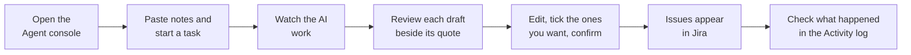
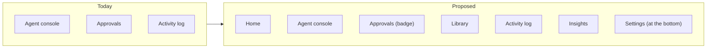

# UX plan: pages and sidebar

This is a plan, not a build. It looks at the app as it is today, says what is missing, and suggests what to add
to the sidebar and in what order. Where it disagrees with [phases.md](phases.md), `phases.md` is what the team
agreed and this is only a proposal.

## The short version

1. **The app has three pages** (Agent console, Approvals, Activity log). They work, but the app has **no starting
   point**: it opens on an empty chat, so a returning user has to hunt for what needs their attention.
2. **Three things are missing:** a **Home** page ("what needs me?"), a **Settings** page ("is it connected, and
   what is the AI allowed to do?"), and a place to see **what the AI created** (a **Library**).
3. **Do two things first, before the end-of-November deadline:** Home and Settings. Each takes about a day and
   needs almost no backend work. Everything else can wait for later phases.

## 1. How someone uses the app today

The main job is: **"I have notes or a story. Turn them into Jira work I can trust."**



Other things people do:

- **Ask a question** about the project (Co-Pilot chat).
- **Break one story into sub-tasks.**
- **Come back later** to review drafts that were waiting.
- **Check the record** of what the AI did and who approved it.

What is missing from this picture:

- Nothing tells you **where to start** or **what is waiting for you**.
- Nothing shows **what has already been created**.
- Nothing lets you **check the setup** ("is Jira connected? which AI model? what can it do?").

## 2. The pages we have, and what to fix

| Page | What it is for | What to improve |
|---|---|---|
| **Agent console** | Do the work: ask the Co-Pilot, or give the Super-Pilot a task. | A first-time user lands in an empty chat, not on the main job. Add a hint about what to do first. While a task runs, say "you can leave this page, we'll tell you when it's ready". Make the Back button return to where you came from. |
| **Approvals** | The inbox of decisions. | It mixes "needs me" and "old stuff" on one page. Split it into two tabs: **Waiting** and **History**. Add search. Show how long each item has waited. |
| **Review a run** | Where you decide on the drafts. | The page is long. Add three tabs: **Drafts** (as now), **Steps** (what the AI did), **History** (what happened to this run). After approving, offer "Open all created issues in Jira" and "Start another task". |
| **Activity log** | The permanent record. | It is a plain table. Make every row link to its run. Add a date range and search. Add an "Export everything" button for the study. |

## 3. The new sidebar



| Item | What it answers | When |
|---|---|---|
| **Home** | "What needs me, and what should I do next?" | First |
| **Agent console** | "I want to ask something or give the AI a task." | Exists |
| **Approvals** | "What is waiting for my decision?" | Exists, improve |
| **Library** | "What went in, and what came out?" | Later |
| **Activity log** | "What did the AI do, and who approved it?" | Exists, improve |
| **Insights** | "Is human oversight actually working?" | Later (needed for the study) |
| **Settings** | "Is it connected, and what is the AI allowed to do?" | First |
| **Automations** | "Set up an AI job that runs by itself." | Phase 8 |

Three rules for the sidebar:

- No more than six or seven items.
- **Never show a page that is empty or says "coming soon".** Add an item only when it works. (This is why the
  disabled "Auto-Pilot" tab should leave the console until Automations exists.)
- Only Approvals gets a number badge.

## 4. The new pages

### Home

**What it is for:** the first thing you see. It answers "what needs me?" and "what can I do?".

**What you see:**

- **Needs you:** drafts waiting for review, how long they have waited, and a Review button. Failed runs show a Retry
  button.
- **Start something:** three buttons: Draft a backlog, Break down a story, Ask the Co-Pilot.
- **Recently:** the last few things that happened, in plain words, each linking to its run.
- **Getting started:** a short checklist for new users (Jira connected, asked a question, ran a draft, approved an
  issue). It also works as onboarding for people in the study.

```
+------------------------------------------------------------+
| Needs you (2)                      | Start something        |
|  Draft backlog · 3 drafts          |  [Draft a backlog]     |
|  waiting 2 h              [Review] |  [Break down a story]  |
|  Break down MCP-8 · failed [Retry] |  [Ask the Co-Pilot]    |
|                                    |------------------------|
| Recently                           | Getting started  2 / 4 |
|  You approved 2 issues             |  [x] Jira connected    |
|  Co-Pilot answered a question      |  [x] Asked a question  |
|                                    |  [ ] Ran a first draft |
|                                    |  [ ] Approved an issue |
+------------------------------------------------------------+
```

**What it needs from the backend:** nothing new. The data already exists.

### Settings

**What it is for:** checking the setup and seeing what the AI is allowed to do. Read-only at first.

**What you see:**

1. **Connections:** the Jira site and project, and the AI model. Each has a **Test** button. It also shows the last
   error, so "out of credit" is visible here and not only inside a failed run. Passwords and keys are never shown.
2. **What each mode can do:** the exact tools the Co-Pilot, Super-Pilot and Auto-Pilot are given. This shows the core
   idea of the project in one place: the Co-Pilot has two read-only tools and nothing more.
3. **Rules and limits:** the nine safety rules in plain words, and the limit on issues per run.
4. **Data and privacy:** what is sent to the AI, how long things are kept, and buttons to delete your chats or stored
   inputs.
5. **Account:** your name and role (once login exists).
6. **About and help:** version, a guide, "report a problem".

**What it needs from the backend:** one new read-only settings call and two "test connection" calls. Sections 2 and 3
use data we already have.

### Library

**What it is for:** answers "where did this come from, and where did it go?". It has two tabs.

**Tab 1: Sources (what goes in).** Today every pasted text lives only inside its run. A library makes it a document
you can reuse.

- A list of saved documents (meeting notes, requirements): title, date added, how many runs used it.
- Open one to see the text and every run drafted from it.
- Actions: "Draft a backlog from this", rename, delete (this removes the text, which helps privacy).
- Later: upload PDF and Word files, and keep the project's rules and conventions here for the AI to use.
- **Needs:** a new place in the database to store documents.

**Tab 2: Created issues (what comes out).** Everything CogniPM created in Jira, in one list.

- For each issue: its key (links to Jira), title, which run created it, who approved it, and **its current status in
  Jira**. So you see what became of the work, not only that it was created.
- We can find these issues because every one carries the label `cognipm-drafted`.
- Later: show changes made in Jira after approval (a useful quality signal), and an **Undo** button where possible.
- **Needs:** one new read-only call. No new database tables.

### Insights (the dashboard)

**What it is for:** answers "is human oversight actually happening, and is the AI any good?". This is the page the
study depends on.

**What you see (all from data we already store):**

| Number | What it tells you |
|---|---|
| How many runs reached a decision | Volume and completion |
| Approval rate, edit rate, rejection rate | How people really use the drafts |
| Time to decide (median and spread) | How much effort review takes, and signs of fatigue |
| Reruns per run | How often the first attempt was not good enough |
| Safety-rule refusals, by rule | What the AI keeps trying that it should not |
| AI cost per run | What a run really costs |

You can filter by date, task and mode, and download the data as a spreadsheet.

**What it needs:** one new read-only call. **One caution:** agree on exact definitions first (what counts as an
"edit", when the "decision" time starts) and only then build the charts.

### Automations (later, Phase 8)

Auto-Pilot means "set it up once and let it run, then review afterwards". That is setup and monitoring, not chat, so
it should be its own page and **not** a tab in the console. It would show active automations (on/off, daily limit,
recent runs) and a form to create a new one, plus the **Undo** controls.

## 5. Things that apply everywhere

- **Plain words.** Keep Co-Pilot, Super-Pilot and Auto-Pilot, but give each a one-line description wherever it first
  appears.
- **Every page needs good empty, loading and error states.** Today an empty page is one short line.
- **Every run link goes to the same review page,** and Back returns to where you came from.
- **Screens:** the console and review pages are built for a desktop. Fine for the study, but check a tablet.
- **Accessibility:** labels and keyboard use are in place, but we have not tested with a screen reader.
- **Notifications** (email or Slack when something is waiting) can come later. The badge on Approvals is enough for now.

## 6. What to build, and when

The MVP deadline is the end of November.

| When | What | Time | Why |
|---|---|---|---|
| **Before the deadline** | **Home** | about 1 day | Gives the app a starting point and a first-run guide for demos. No backend work. |
| **Before the deadline** | **Settings** (read-only) | about 1 day | Makes "what can the AI do" visible and shows connection errors. |
| After the MVP | Approvals tabs, run tabs, Activity links and export | about 2 days | Polishes the main loop using feedback from testers. |
| Phase 7 | Account menu and roles | with login | Needed before anyone outside the team uses it. |
| Phase 8 | **Automations**, then Library → Created issues | 3 to 4 days | Auto-Pilot needs its own page. The issue list is most useful once Undo exists. |
| Phases 9 and 10 | **Insights**, Library → Sources, onboarding guide | 4 to 5 days | Insights is the study's main tool, and its numbers must be defined first. |

**Not recommended:** building Home, Insights and Library all at once. Home and Settings are small and unblock a
demo. The others are only useful once the work behind them exists.

## 7. Questions for the team and supervisor

1. Should participants see their own oversight numbers, or only we do? Seeing their own edit rate may change how
   they behave.
2. Is "Library" the right name, or should "Documents" and "Created issues" be separate items?
3. Should the sidebar say "Automations" or keep the name "Auto-Pilot"?
4. How long should we keep inputs and chats? This decides the wording in Settings and the Library delete button.
5. Will participants use a hosted copy, or run it on their own machines? That changes the first-run checklist.
