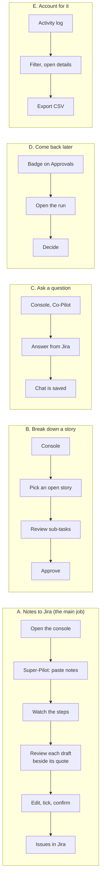
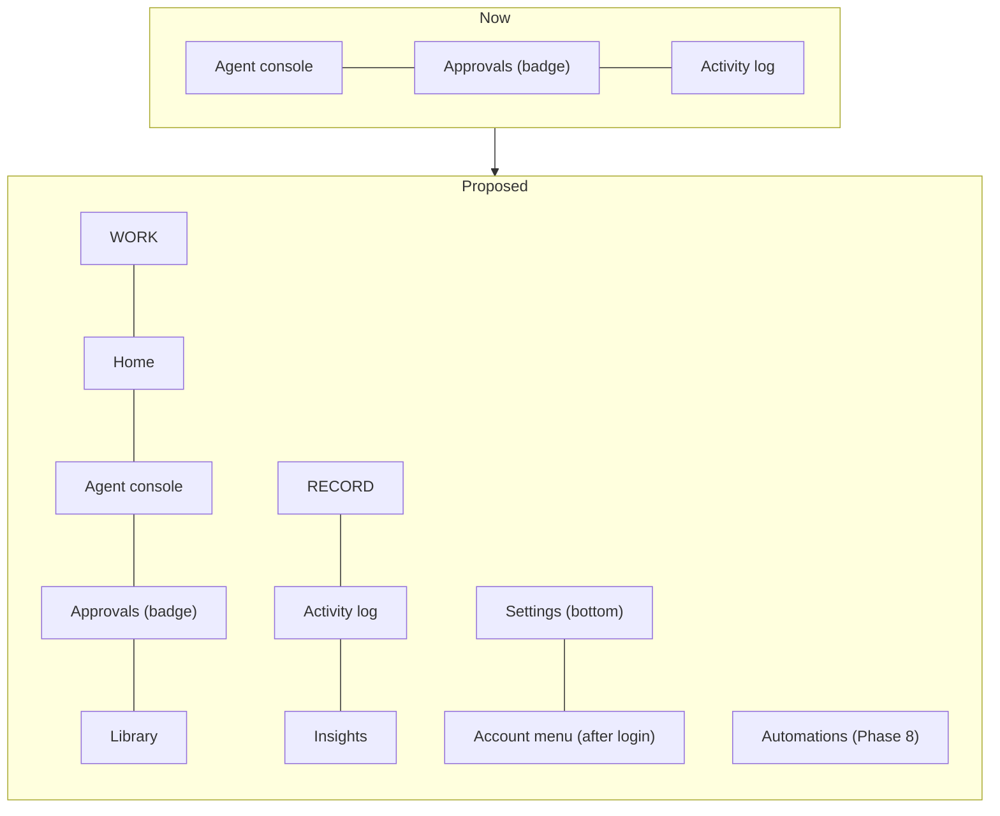

# UX plan: user flow, pages and sidebar

A plan, not a build. It looks at the app as it is on 22 Nov (three screens: Agent console, Approvals, Activity log),
walks it as a user would, says what is weak about each page, and proposes what to add to the sidebar and when.
Read it with [architecture.md](architecture.md) (why the product works this way) and [phases.md](phases.md) (what is
scheduled). Where this plan and `phases.md` disagree, this one is a proposal and `phases.md` is what is agreed.

## 1. Who uses it and what they are trying to do

| Person | Their question | Where they spend time |
|---|---|---|
| **PM (the main user)** | "I have notes or a story: turn them into Jira work I trust, quickly." | Console, Approvals |
| **PM, a day later** | "What is waiting for me? What did the agent do while I was away?" | Home, Approvals, Activity |
| **Developer or stakeholder (after login, Phase 7)** | "What was created, and why?" | Library, Activity (view only) |
| **Researcher (us, and the study)** | "Do people review properly? Where do they override the agent?" | Dashboard, Activity export |

The study is why oversight is visible everywhere: every screen should answer "what did the AI do, and who decided".

## 2. The journeys



What is missing from this picture: there is no **starting point** (the app opens straight on the console, so journey D
and E begin with the user hunting through the sidebar), no place to see **what has already been created**, and nowhere
to **check or change how the system is set up** (journey F: "is it connected, which model, what is it allowed to do?").

## 3. The current pages, walked as a user

### Agent console (`/console`)
**Purpose:** do the work: ask (Co-Pilot) or hand over a task (Super-Pilot).
**Works:** one frame in both modes (history on the left, work area on the right); chats saved with folders; the task
form and live progress are side by side; "Review and approve" appears when drafts are ready.
**Weak:**
- A first-time user lands in an empty Co-Pilot chat. The Super-Pilot (the main job) is one click away but not
  suggested. There is no "what do I do first".
- After starting a task the user watches the steps, but nothing says how long it takes or that they can leave. They
  can leave (the badge appears), but the page does not tell them.
- Past tasks are in the left list but open the *Approvals* review, which is a different page and loses the console
  context. Fine, but the back link goes to the Approvals list, not to where they came from.
- "Auto-Pilot, Soon" is a dead tab. See section 5: it should not live here.
**Plan:** keep as the working page. Add a first-run hint, a "you can leave this page" line while a run is working, and
make Back return to where the user came from.

### Approvals (`/approvals`)
**Purpose:** the inbox of decisions. **Works:** waiting runs first, oldest first; earlier runs in a table.
**Weak:** it mixes "what needs me" and "history" on one page; no search or filter; no count by age; a run with failed
status is easy to miss; "Earlier runs" will get long.
**Plan:** split into two tabs, **Waiting** and **History** (with a status filter and search by scope). Show how long each
has waited and flag anything older than a day. Failed runs that can be retried appear in Waiting.

### Review a run (`/approvals/:id`)
**Purpose:** the decision screen, and the study's key instrument. **Works:** quote highlighted in the original input,
assumptions flagged, nothing ticked by default, one confirmation naming the count, links to created issues.
**Weak:** long page: header, drafts, source pane, decision bar all compete; no per-run timeline (steps and audit are
only in Activity); after approval the user has no "next" (open in Jira is there, nothing else); mobile is poor.
**Plan:** add three tabs inside a run: **Drafts** (as now), **Steps** (the run's step trace and token use), **History**
(that run's audit rows). Put "Open all created issues in Jira" and "Start another task" on the approved state.

### Activity log (`/activity`)
**Purpose:** the record. **Works:** plain wording, filters, details, group by run, CSV.
**Weak:** it is a raw table; the only link to a run is in grouped mode; no date range or search; no per-actor view;
the export is whatever is on screen (max 500).
**Plan:** link every row's run id; add a date range and text search; "Export all" as a server-side CSV with a date range
(needed for the evaluation).

### Not found
Fine. Add a link back to Home once Home exists.

## 4. Proposed sidebar



| Item | Why it earns a place | Priority |
|---|---|---|
| **Home** | A starting point: what needs me, what to do next. Today the app opens on an empty chat. | **High** |
| **Agent console** | Unchanged. | exists |
| **Approvals** | Unchanged, with Waiting and History tabs. | exists, improve |
| **Library** | Everything the system holds or made: the **source documents** that went in and the **issues** that came out. | Medium |
| **Activity log** | Unchanged, plus links and a server-side export. | exists, improve |
| **Insights** (the "dashboard") | The oversight metrics the study needs. Separate from Home on purpose: Home is for acting, Insights is for judging. | Medium (needed by Phase 10) |
| **Automations** | Auto-Pilot is configuration and monitoring, not a conversation. It does not belong inside the console. | Phase 8 |
| **Settings** | What is connected, what each mode may do, limits, data and privacy. | **High** (small first version) |
| **Account menu** | Who is signed in and their role. | Phase 7 (login) |

Rules for the sidebar: at most six items, no item that opens an empty or "coming soon" page (hide it until it works),
the badge only on Approvals, Settings pinned at the bottom.

## 5. The new pages

### Home (`/`)
**Question it answers:** "What needs me, and what should I do next?"
**Contents:**
- **Needs you:** runs waiting for review (count, how long the oldest has waited), each with a Review button. Failed runs
  that can be retried. If empty: "Nothing is waiting."
- **Start something:** three cards: Draft a backlog, Break down a story, Ask the Co-Pilot (deep links into the console).
- **Recently:** the last five things that happened, in plain words, each linking to its run.
- **First-run checklist** (until done): Jira connected, asked a first question, ran a first draft, approved a first issue.
  This doubles as participant onboarding for the study (Phase 10).
**Data:** existing `GET /api/runs`, `GET /api/audit?limit=5`, `GET /api/project`. No backend work for v1.

```
+------------------------------------------------------------+
| Good morning                                               |
| +--------------------------+ +---------------------------+ |
| | Needs you (2)            | | Start something           | |
| | Draft backlog  · 3 drafts| | [Draft a backlog]         | |
| |   waiting 2 h  [Review]  | | [Break down a story]      | |
| | Break down MCP-8 · failed| | [Ask the Co-Pilot]        | |
| |   [Retry]                | +---------------------------+ |
| +--------------------------+ | Getting started  2 of 4   | |
| Recently                     | [x] Jira connected        | |
| · You approved 2 issues      | [x] Asked a question      | |
| · Co-Pilot answered ...      | [ ] Ran a first draft     | |
|                              | [ ] Approved an issue     | |
+------------------------------------------------------------+
```

### Insights (`/insights`), the oversight dashboard
**Question it answers:** "Is human oversight actually happening, and is the agent any good?"
**Contents (all from data we already store):**

| Metric | From | Why it matters |
|---|---|---|
| Runs, and how many reached a decision | `runs.status` | volume and completion |
| **Approval rate, edit rate, rejection rate** | `staged_changes.status`, `edited_payload` | the study's core outcomes |
| **Time to decision** (median, spread) | `runs.ready_at` to `decided_at` | review effort; fatigue signal |
| Reruns per run | `runs.rerun_of` | how often the first attempt is not good enough |
| Guardrail refusals, by rule | `audit_log` (`guardrail:*`) | what the agent keeps trying that it should not |
| Tokens per run, by model | `runs.input_tokens`, `output_tokens` | cost, and what a run really costs |
| Items cited with a quote the PM edited | drafts with edits | whether sources help |

Filters: date range, task (P1/P2), mode. A "Download data" button gives the underlying rows as CSV.
**Needs:** one new read-only endpoint, `GET /api/insights?from=&to=`. No new tables.
**Caution:** this is the page the evaluation depends on, so build it with the metrics *defined first* (an agreed
definition of "edit rate" and "time to decision" in `phases.md`), not the charts first.

### Library (`/library`): documents and artifacts
Two tabs. This is the answer to "where did that come from, and where did it go?".

**Sources (the documents that go in).** Today every input is pasted and lives only inside its run. A library makes it a
thing: a titled document (meeting notes, a requirements doc) the PM can reuse, re-run, and see what it produced.
- List: title, type, added, used in N runs. Open one to see the text and every run drafted from it.
- Add: paste or upload `.txt`/`.md` now; **PDF, Word and transcripts** later (hardening item H12).
- Actions: "Draft a backlog from this" (opens the console with it loaded), rename, delete (removes the text; privacy,
  H4).
- Later (Phase 9): the project's definition of done and conventions live here as **knowledge documents** for retrieval.
- **Needs:** a `documents` table and `GET/POST/DELETE /api/documents`; the console's "paste" box can save as a document.

**Created issues (the artifacts that come out).** Everything CogniPM created in Jira, in one place.
- List: issue key (links to Jira), title, type, created by which run and who approved it, **its current status in
  Jira**, created date. Filter by run, status, type.
- The current status comes from Jira (search by the `cognipm-drafted` label we already add), so the PM sees what became
  of the work, not just that it was created.
- Later: show edits made in Jira after approval (a quality signal for the study), and **Undo** where reversible
  (Phase 8c).
- **Needs:** `GET /api/artifacts` (our `staged_changes` with `created_issue_key`, joined to a Jira search). No new tables.

### Settings (`/settings`)
Read-only and honest first; editable later. Sections:
1. **Connections:** Jira (site, project, signed in as, **Test connection**) and the model (name, key present, **Test**,
   and the last error, so "credits depleted" is visible here and not only inside a failed run). Secrets are never shown.
2. **What each mode can do:** the three modes with the exact tools each is given, straight from `GET /api/modes`. This is
   the thesis made visible ("the Co-Pilot has two tools and no more").
3. **Guardrails and limits:** the nine rules in plain words, and the current limit (issues per run). Editable limits
   later.
4. **Data and privacy:** what is sent to the model, how long runs and chats are kept, delete my chats / delete stored
   inputs, export my data. (Hardening item H4.)
5. **Account** (after login): name, role.
6. **About and help:** version, the guide, "report a problem".
**Needs:** `GET /api/settings` (no secrets) and two `POST` test endpoints. Everything in 2 and 3 is data we already have.

### Automations (`/automations`), Phase 8
Auto-Pilot is "set it up once, let it run, review afterwards", which is configuration and monitoring, not chat. So: a
page with **Active** (toggle, daily limit, last runs, pause) and **New automation** (task, trigger, allowed tools and
fields, shadow period), plus the **Undo** controls from `phases.md` Phase 8c. **Remove the disabled "Auto-Pilot" tab
from the console until this exists.**

## 6. Cross-cutting

- **Language:** keep Co-Pilot / Super-Pilot / Auto-Pilot, but give each a one-line plain description wherever it first
  appears (done in the console; add on Home and Settings).
- **States:** every page needs designed empty, loading, error and "no permission" states. Today empties are one line.
- **Navigation:** every run reference (in Activity, Insights, Library, Home) links to its review page; every review has
  a Back that returns to where the user came from.
- **Responsive:** the console and review are desktop-first; acceptable for the study, but check 1024px and tablet.
- **Accessibility:** labels, roles, focus and reduced motion are in; not yet tested with a screen reader or against
  contrast on the tinted pills.
- **Notifications:** later, email or Slack when a run awaits review (hardening item H13). The sidebar badge is the MVP.

## 7. Order of work

Dates are for the MVP, due end of November, and `phases.md` Phases 7 to 10.

| When | Build | Size | Why now |
|---|---|---|---|
| **Before the MVP freeze** | **Home v1** (needs you, start something, recent, checklist) | about 1 day | Gives the app a starting point and the first-run guidance a demo needs. No backend work. |
| **Before the MVP freeze** | **Settings v1** (connections with test, modes and tools, guardrails, read-only) | about 1 day | Makes "what can the agent do" visible, and surfaces credit and connection errors. |
| After the MVP | Approvals tabs (Waiting/History), run tabs (Steps/History), Activity links and export | 2 days | Polishes the core loop from evaluation feedback. |
| Phase 7 | Account menu and roles | with login | Needed before anyone outside the team uses it. |
| Phase 8 | **Automations** page, then **Library, Created issues** (uses undo) | 3 to 4 days | M3 needs its own page; artifacts are most useful once undo exists. |
| Phase 9 and 10 | **Insights**, **Library, Sources**, knowledge documents, onboarding guide | 4 to 5 days | Insights is the evaluation's instrument and needs agreed metric definitions first; Sources needs upload and extraction. |

Not recommended now: a separate Home *and* Insights *and* Library all at once. Home and Settings are small, visible
and unblock a demo; the rest wait for the work that makes them meaningful.

## 8. Questions for the team and supervisor

1. Should the study's metrics be visible to participants (Insights) or only to us? Showing a participant their own edit
   rate may change how they behave.
2. Is "Library" the right name, or would the team say "Documents" and "Artifacts" separately?
3. Do we keep the Auto-Pilot name in the sidebar (Automations) or keep it as a mode label only?
4. How long should inputs and chats be kept? This decides the wording on Settings and the Library delete action.
5. Is a hosted deployment needed for participants, or does each person run it locally? That changes Home's first-run
   steps (a hosted app needs no setup checklist item for Jira).
